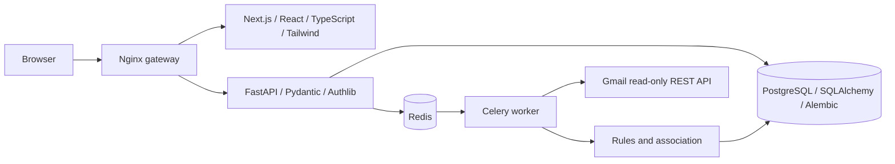
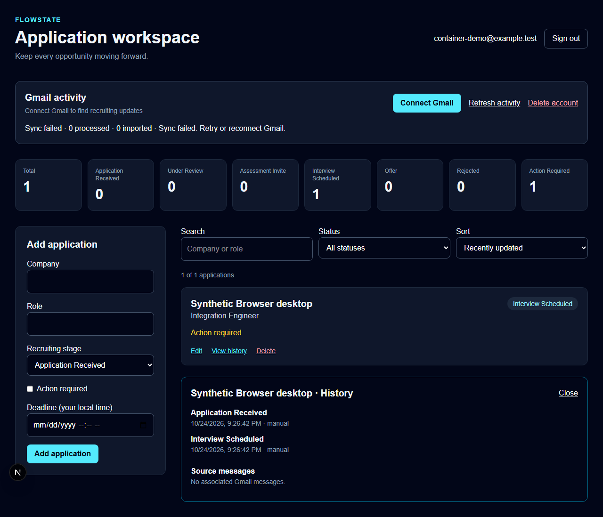
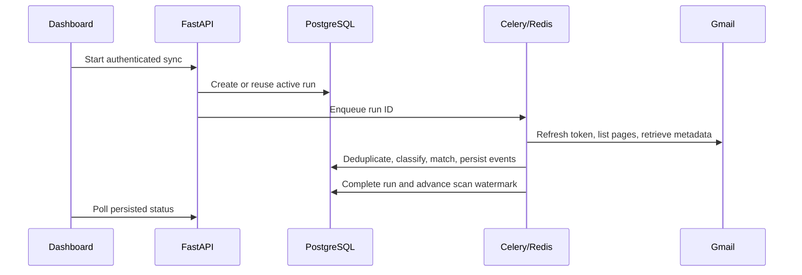
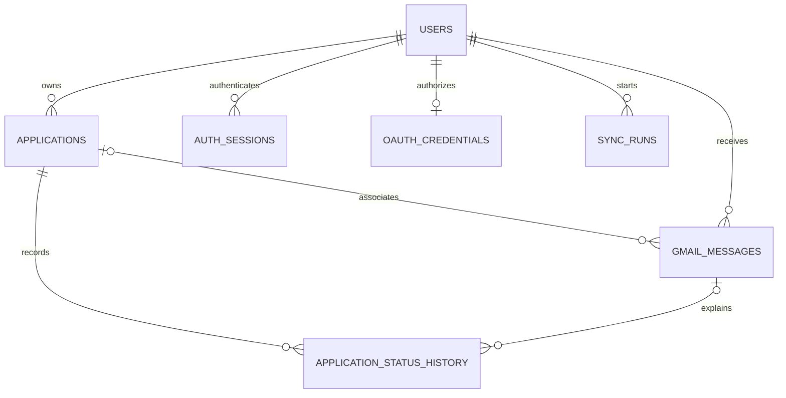
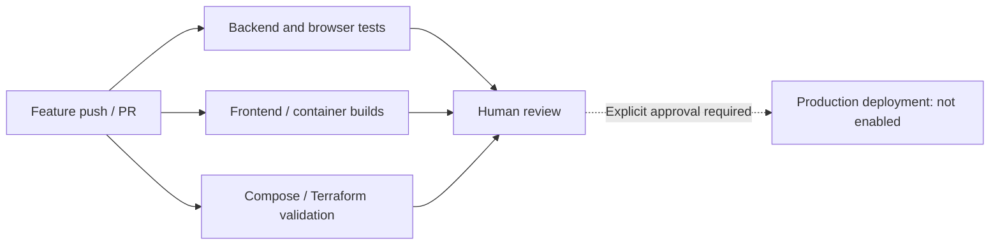
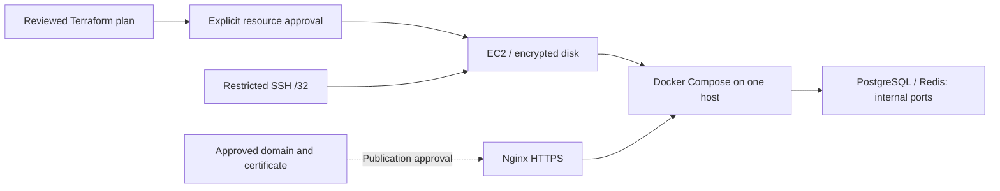

# FlowState

A Gmail-powered job application tracker built with Next.js, FastAPI,
PostgreSQL and Celery. Track applications manually, connect Gmail with read-only
consent, and review recruiting updates with their source-message context.

**Project status:** core product verified locally, including real Google login,
Gmail consent and a completed live sync. Automated workflows pass with real
PostgreSQL/Redis/Celery, Compose and local Kubernetes ingress. VM automation,
Packer and both AWS Terraform configurations are prepared and validate; actual
VM/cloud deployment, public HTTPS and live Pub/Sub remain external checkpoints.
See [progress](docs/PROGRESS.md) and the
[22-stage implementation plan](docs/IMPLEMENTATION_PLAN.md).

## Features implemented in code

- Private application CRUD with ownership checks, validation, search, filters,
  sorting, pagination and status history.
- Six recruiting stages: Application Received, Under Review, Assessment Invite,
  Interview Scheduled, Offer and Rejected. Action Required is a separate reminder
  flag, so a deadline does not erase the recruiting stage.
- Google OIDC, revocable server-side sessions, HttpOnly cookies, origin checks
  for mutations and encrypted refresh tokens using an external Fernet key.
- Gmail metadata polling with pagination, incremental overlap, scoped identifier
  deduplication and durable sync progress.
- Conservative deterministic classification, exact identity/thread matching,
  manual review, event ordering and protection for manual status corrections.
- Responsive dashboard with real API data, metrics, editing, history, source
  messages, review decisions, Gmail controls, disconnect and account deletion.
- Celery task claims/retries, Docker development/production configurations,
  Nginx routing, basic EC2 Terraform and CI checks.

## Architecture



SQLAlchemy transactions keep status changes and history consistent. Database
records are scoped to the authenticated user. Redis carries task messages;
PostgreSQL stores permanent synchronization history. The worker requests
metadata rather than full email bodies or attachments.



Actual UI captured during a browser test against the local container stack.
Every account/application is synthetic. The displayed failed sync is a deliberate
missing-credential test, not a live Gmail result.
[Mobile capture](docs/screenshots/synthetic-container-mobile.png).





## Local development

Prerequisites: Python 3.12, Node.js 22, PostgreSQL, and Redis/Linux Celery workers
(Docker is recommended for workers on Windows).

```powershell
python -m venv .venv
.\.venv\Scripts\Activate.ps1
python -m pip install -r requirements.txt
# Copy .env.example to apps/api/.env only if you do not already have that file.
# Configure credentials locally; never commit them.
python -m alembic upgrade head  # NEW empty database only; see warning below
python -m uvicorn apps.api.main:app --reload --no-access-log
```

In a second terminal:

```powershell
cd apps/web
npm ci
npm run dev
```

Visit http://localhost:3000. API docs: http://localhost:8000/docs.
Existing pre-migration databases need inspection, backup and deliberate baseline
registration before upgrade. Read [database migration guidance](docs/DATABASE.md).
Do not run create_all or stamp an arbitrary existing schema.

| Variable | Purpose |
|---|---|
| DATABASE_URL | PostgreSQL SQLAlchemy URL using psycopg |
| SESSION_SECRET | At least 32 random characters, separate per environment |
| FRONTEND_URL | Exact trusted browser origin; HTTPS in production |
| GOOGLE_CLIENT_ID / GOOGLE_CLIENT_SECRET | Web OAuth client, kept local/secret-managed |
| GOOGLE_REDIRECT_URI | Exact registered API callback URL |
| TOKEN_ENCRYPTION_KEY | Fernet key for refresh-token encryption |
| REDIS_URL | Celery broker URL |
| APP_ENV | development or production |
| NEXT_PUBLIC_API_URL | Browser API URL, set at frontend build time |
| POSTGRES_PASSWORD | Separate root Compose environment value for its DB |

Generate an encryption key locally with
`python -c "from cryptography.fernet import Fernet; print(Fernet.generate_key().decode())"`
and store it in the ignored environment file or a secret manager. Do not paste
it in chat. See [manual Google setup](docs/MANUAL_STEPS.md) and
[Gmail/security behavior](docs/GMAIL.md). Signing in and connecting Gmail are
separate actions. Google consent/verification approval is not claimed.

## Docker

Configure apps/api/.env and a root ignored .env containing a unique URL-safe
POSTGRES_PASSWORD. Then:

```sh
docker compose -f compose.yml -f docker-compose.dev.yml up --build
```

This creates a separate PostgreSQL volume, Redis, migration service, API,
frontend and worker. Host ports bind to loopback; DB/Redis have no published
ports. State survives container recreation. Never delete volumes to redeploy.
The production-shaped configuration adds optimized builds and Nginx /api/
forwarding but requires approved HTTPS setup before actual production use.
See [container guide](docs/CONTAINERS.md).

## Validation and CI

```sh
python -m unittest discover -v
# In apps/web:
npm run lint
npx tsc --noEmit
npm run build
npx playwright install chromium
npm run test:e2e
```

Tests use synthetic email fixtures, isolated SQLite databases, mocked Gmail and
browser API fixtures. Set FLOWSTATE_TEST_DATABASE_URL only to a dedicated test
PostgreSQL database to run the API suite in isolated temporary schemas. Never
point that variable at a production database. CI additionally validates migrations
against PostgreSQL, container configurations/builds and Terraform. Local pass
results do not imply remote CI or deployment success; consult PROGRESS.md.



## Deployment



[Initial EC2 Terraform](infra/terraform/README.md) defaults public web ingress
off, requires a specific SSH administrator address and uses IMDSv2. No cloud
resources have been created. [Deployment runbook](docs/DEPLOYMENT.md) covers
host preparation, secure configuration, reviewed releases, backups, migrations,
health checks, Nginx/TLS and recovery. No production automatic deployment is
enabled. AWS compute, storage and IPs can incur charges; apply requires approval.

## Extended infrastructure

- [Three-VM Vagrant lab](infra/vagrant/README.md) and
  [Ansible roles](infra/ansible/README.md): isolated app/data/monitoring networks,
  secure configuration, Docker deployment and private monitoring. Syntax checked;
  provider installation, actual provisioning and second-run idempotence pending.
- [Packer](infra/packer/README.md): validated Ubuntu/Docker image definition with
  security updates and monitoring prerequisites; no paid image build performed.
- [Kubernetes](infra/kubernetes/README.md): kind, persistent storage, migration Job,
  restricted workloads/probes and Traefik ingress passed actual local workflows.
- [Managed AWS](infra/terraform-managed/README.md): reusable two-AZ network,
  private encrypted Multi-AZ RDS/Redis, ALB, SSM, least-privilege runtime secret and
  CloudWatch permissions. Terraform validates; no account plan/apply performed.
- [Private monitoring](infra/monitoring/README.md): actual Prometheus scrapes,
  dependency gauges and provisioned Grafana dashboard verified with synthetic data.
- [Optional Gmail push](docs/GMAIL_PUSH.md): authenticated Pub/Sub receiver,
  watch/history, renewal and polling recovery tested synthetically. No public
  subscription created; [verification/privacy preparation](docs/GOOGLE_VERIFICATION.md)
  requires owner review before publication.

## Security, privacy and limitations

Tokens and full email bodies do not reach browser JavaScript. Logs use route
templates/request IDs and omit query strings and message contents. Disconnect
revokes Google consent and deletes metadata while retaining applications;
account deletion removes local account data. Operational backups require their
own encrypted storage, retention and deletion policy.

Classification intentionally favors review over incorrect automatic entries.
Initial scans cover one year; incremental scans overlap one day. Unknown employer
or role, conflicting signals and generic ATS senders need review. Date extraction
supports ISO dates. Manual stages remain locked against automatic updates.
Interrupted syncs are requeued by a single Beat scheduler after a 15-minute stale
heartbeat window, with bounded recovery attempts. Optional authenticated Gmail push/history is implemented and disabled pending
public HTTPS/PubSub setup. Production Google verification and cloud deployment
remain pending. Development and optimized
production-shaped stacks passed local health/proxy checks; authenticated browser
CRUD passed against the real development containers on desktop and mobile.

For contribution, troubleshooting and configuration details, read
[DEVELOPMENT.md](docs/DEVELOPMENT.md), [ARCHITECTURE.md](docs/ARCHITECTURE.md),
[PROGRESS.md](docs/PROGRESS.md) and [MANUAL_STEPS.md](docs/MANUAL_STEPS.md).
Preserve user changes, keep secrets ignored, test coherent increments, and use
feature branches. Never merge to main or provision/expose paid services without
the project owner's approval.
