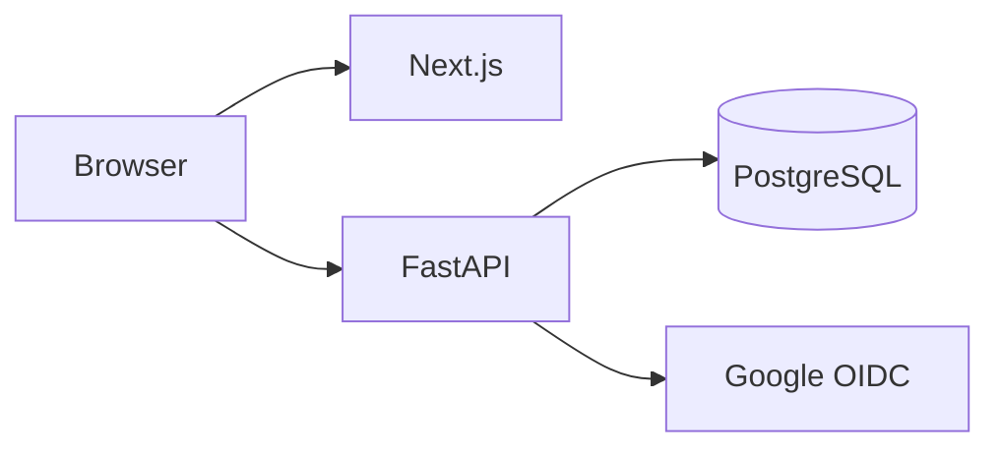
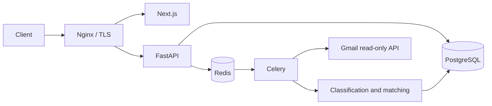

# FlowState architecture

## Existing system and target

Next.js in apps/web talks to FastAPI in apps/api. PostgreSQL is accessed through
SQLAlchemy sessions. Authlib handles Google OIDC authorization. The original
application endpoints used a shared dictionary; replacing this with owned
database records is the first implementation priority.

Planned (not yet operational):

Keep recruiting stage separate from action-required flags and deadlines. Scope
every application and Gmail identifier to its owner. Preserve status provenance,
avoid redundant history, and prevent uncertain automation from overwriting user
corrections. Persist sync runs in PostgreSQL rather than relying on Redis results.
Never store full email bodies by default or log tokens/message content.

Credentials belong in ignored local environment files or a secret manager.
No cloud resources, public endpoints, or production deployment are authorized
until the explicit checkpoints in the user's roadmap are satisfied.
